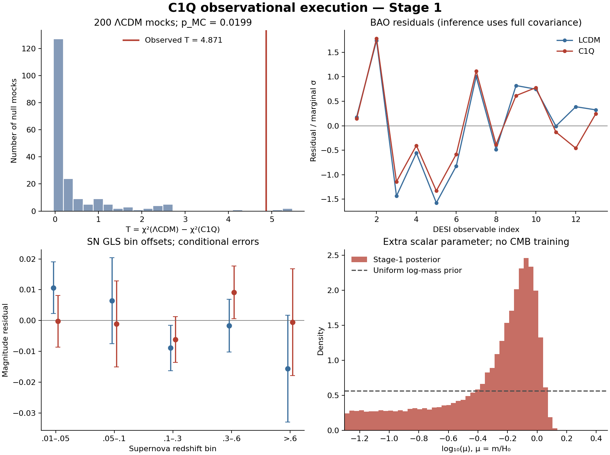

# C1Q observational execution: 25 October 2026

This run executes the DESI DR2 BAO + Pantheon+ training stage of the frozen C1Q protocol. It preserves the immutable point and reports the separately fitted family. Full posterior-predictive Planck validation and a future independent release remain incomplete.

## Fitted-family result

| Model | BAO χ² | SN χ² | Total χ² |
|---|---:|---:|---:|
| LCDM | 10.883137 | 1405.286392 | 1416.169529 |
| C1Q | 8.741852 | 1402.556627 | 1411.298479 |

For comparison, the immutable-point totals were ΛCDM 1431.122368 and C1Q 1422.245758, an improvement of 8.876609. Only the common SN magnitude was profiled at those fixed points; that advantage is not the family-selection statistic.

T = 4.871050; ΔAIC(C1Q−ΛCDM) = -2.871050. AIC is descriptive, not a p-value. Direct CLASS evaluations at the fitted coordinates give T = 4.871050; the direct checks passed the declared |Δχ²|<0.01 tolerance.

Of 200 full-covariance null mocks, 3 had T at least as large as observed. p_MC = 0.01990050; the 95% binomial interval for the underlying tail probability is [0.003104107621553509, 0.0432082819177126]. The finite-resolution floor is 1/201 = 0.00497512. Every mock comparison passed the declared optimizer convergence checks: True. Failed indices: [].

**The protocol's training screen does not pass.** This alone cannot establish the protocol's full model-development signal, which also requires held-out predictive improvement and the other gates.

## Posterior intervals

Uniform priors are exactly those in the original protocol. Primordial amplitude and tilt integrate out. Reionization is retained as a common parameter because its small effect on CLASS r_drag failed the initial numerical-invariance check; this distance-only stage is not a useful independent reionization measurement. Quoted intervals are conditional on the model, fixed physical conventions and chosen priors.

| Model | Parameter | Median | 68% interval | 95% interval |
|---|---|---:|---|---|
| LCDM | H0 | 68.9869 | [67.5502, 70.3213] | [66.7496, 71.1017] |
| LCDM | omega_b | 0.0226377 | [0.020866, 0.0242734] | [0.0201284, 0.0248925] |
| LCDM | omega_cdm | 0.121382 | [0.11568, 0.127335] | [0.110893, 0.132895] |
| LCDM | z_reio | 8.49955 | [6.14347, 10.8871] | [5.19147, 11.8269] |
| C1Q | H0 | 67.8311 | [66.229, 69.4526] | [64.7836, 70.6014] |
| C1Q | omega_b | 0.0227022 | [0.0208979, 0.0243051] | [0.0201476, 0.0248929] |
| C1Q | omega_cdm | 0.116485 | [0.109562, 0.123551] | [0.103426, 0.130023] |
| C1Q | z_reio | 8.53829 | [6.13114, 10.9119] | [5.1752, 11.8332] |
| C1Q | mu | 0.637059 | [0.183741, 0.919152] | [0.062034, 1.10145] |

H0 is in km s^-1 Mpc^-1. Distance-scale estimates are conditional on the specified baryon-density prior. The best-fit omega_b values reach opposite prior boundaries (0.025 for LCDM and 0.020 for C1Q), while the posterior spans most of that prior.

The C1Q maximum-likelihood point has mu=0.858454 and present scalar equation of state w_phi=-0.893615. These point estimates are separate from the posterior intervals above.

LCDM chain IAT/stability convergence gate: True; estimated effective samples [3542.2644360042864, 3528.0563875296384, 3653.882960448638, 2970.5170336140154]. IAT and stability checks for one ensemble; not four independent-chain R-hat verification.
C1Q chain IAT/stability convergence gate: True; estimated effective samples [3567.58878626344, 4467.526486333557, 3650.389296972746, 4185.823500058285, 2061.1726752741397]. IAT and stability checks for one ensemble; not four independent-chain R-hat verification.

## Residuals and numerical validity

Full correlated BAO and SN residual tables are included. The predeclared residual summaries use marginal BAO standardization, a covariance-weighted SN log(1+z) trend and five GLS SN bins. Their Monte Carlo references reuse the matched-ΛCDM mocks; they are neither independent holdouts nor proof that no systematic remains.

- LCDM residual diagnostic Monte Carlo tail fractions: {'max_abs_bao_marginal_sigma': 0.5771144278606966, 'abs_sn_log1pz_trend': 0.09950248756218906, 'max_abs_sn_bin_standardized_offset': 0.572139303482587}.
- C1Q residual diagnostic Monte Carlo tail fractions: {'max_abs_bao_marginal_sigma': 0.5522388059701493, 'abs_sn_log1pz_trend': 0.7810945273631841, 'max_abs_sn_bin_standardized_offset': 0.6567164179104478}.

Surrogate independent validation passed: True (164 direct full-thermodynamic comparisons). The original nine numerical background gates were rerun and passed. Three preselected family masses also passed an independent Python/CLASS H and w cross-check. These finite checks are not a global numerical proof.

The first interpolation runs failed because of CLASS scalar-amplitude bracketing and an initialization check at grid points outside the physical prior. The accepted numerical adapter uses C1Q’s documented positive-amplitude bracket scan; equations, initial surface, potential and priors were unchanged. The immutable χ² changed by only 5.1e-11. A later validation rejected the initial distance/sound-horizon approximation before fitting. The corrected implementation factors exact H0 scaling, uses h^-2 for the remaining background dependence, retains the original common reionization parameter, and uses full thermodynamic correction tensors. See IMPLEMENTATION_REVISION_V2.md. Failure logs and corrections are retained.

## Planck scope

LCDM immutable-point Planck nuisance-profile objective (−2 log likelihood plus stated nuisance-prior penalties): 2784.790005; nuisance convergence: True; reference-to-tighter numerical objective change: -0.587859.
C1Q immutable-point Planck nuisance-profile objective (−2 log likelihood plus stated nuisance-prior penalties): 3696.696848; nuisance convergence: True; reference-to-tighter numerical objective change: -3.700434.

Conditional fixed-point objective difference, C1Q−ΛCDM: 911.906843. This is not a fitted-family comparison, marginalized evidence, or posterior-predictive score.

All four public Planck likelihood packages loaded and their supplied checks ran. The additional point diagnostic holds the primordial/reionization parameters fixed, profiles the same Planck foreground/calibration prescription, and retains the original linear-theory setting. A full Stage-2 result still requires integration over the Stage-1 posterior and common nuisance priors, a defensible predictive-score uncertainty calculation, and assessment of nonlinear-lensing effects. A later independent distance/growth release has not been selected or tested.

## Evidence status and independence

- **Demonstrated computationally:** the numerical reproduction, verified data acquisition, fitted likelihoods and the completed mock calculations documented in this bundle.
- **Supported but incomplete:** any apparent training advantage is conditional on the specified priors, likelihood implementation and convergence diagnostics.
- **Unresolved:** full held-out posterior prediction and a future independently selected release.
- **Not demonstrated:** new fundamental physics, empirical proof of EFMW, or the full protocol’s model-development signal.

The frozen physical model is GR with a canonical quadratic quintessence field and standard minimally coupled matter. These calculations do not establish novelty of that model class. The normalization x_initial is solved from flatness and is not independent empirical validation or an extra fitted coordinate.

The protocol is an internal prospective record, not an independently registered or blinded experiment. These public datasets and their broad results were known. Training uses 13 correlated DESI observables and 1,590 selected Pantheon+ rows (1,473 unique objects); duplicate light-curve rows are kept with the full released covariance. SN absolute magnitude is analytically marginalized/profiled with the same flat prior; SH0ES Cepheid calibration is not used. Released DESI and SN blocks are treated as independent because a joint cross-survey covariance is not supplied. The mocks preserve the released covariance and fixed redshift selection, not an end-to-end survey simulation.

The two-family null calibration does not calibrate a broader search over EFMW equations. Neither a negative result nor an incomplete gate proves that every EFMW candidate is impossible.

## Provenance and reproduction

Source model: `enuminous/Cosmology@f457a1fc414257d5e4d2ddbeb8985db2cb714363`. CLASS: `lesgourg/class_public@814ce59c380a5cccd0bed1747a384ff7bfc1f9cf`, with the original adapter followed by the recorded numerical family-shooting patch. Clipy: `CobayaSampler/clipy@4260853bbc6a6e998896ef2b22b48161209562c5`. Exact data URLs and byte hashes are in the acquisition manifests. Runtime package versions and adapter hashes are included.

See `REPRODUCE.md` for commands. The bundle contains the new observational work, result tables, chains, accepted interpolation coefficients, manifests and failure logs. Original frozen repository files are unchanged. Public Planck data and raw interpolation training arrays are excluded from the compact bundle; their acquisition/build scripts and identities are retained.
