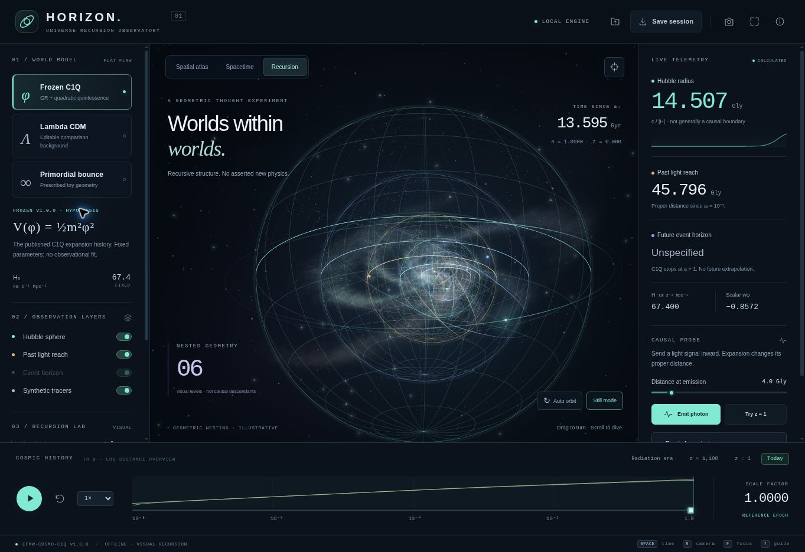

# HORIZON — Universe Recursion Observatory

A dependency-free, offline desktop-style cosmology explorer. Download the repository's [`index.html`](../index.html) and open it directly in a current browser. The single file contains the interface, rendering engine, physics code and all 1,001 frozen C1Q background samples. No installation, server, account or network connection is required to use it. The source links in the field guide require a connection only if clicked.



## Explore

- **Spatial atlas:** orbitable projected 3D horizon spheres, procedural stellar tracers and filaments, and a marked observer. Radial distances are compressed for display.
- **Spacetime:** computed conformal-coordinate curves, the current past light cone and an optional inward photon trajectory.
- **Recursion:** 2–10 geometrically nested scenes with adjustable scale ratio, three palettes and procedural nebulae. This is visual artwork, not daughter-universe dynamics.
- **Cosmic time:** scrub the background history, select reference epochs or play the timeline at 0.5×–4×. Playback stops at the displayed domain boundary.
- **Causal probe:** set a proper emission distance, emit an inward photon and follow its distance or arrival. “Try z = 1” provides an example inside the stored C1Q history.
- **Portable outputs:** save/open JSON sessions, capture labeled PNGs and export 1,001 calculated samples as CSV through the field guide.

Drag the scene to orbit, scroll to zoom, press **Space** to play/pause, **R** to reset the camera, **F** for focus view, and **?** for the field guide. Arrow keys move time; hold Shift for larger steps. Native controls keep their normal keyboard behavior. Still mode and the system's reduced-motion preference stop decorative animation. Focus view is an in-page presentation layout, not an operating-system full-screen request.

## Model and evidence boundaries

| Background | What is calculated | Domain and limitation |
| --- | --- | --- |
| Frozen C1Q v1.0.0 | Interpolation of the original scalar-field background; elapsed time, Hubble scale and finite past light reach | a = 10^-8 to 1. Parameters remain fixed. No future event horizon is inferred; no observational likelihood is evaluated. |
| Flat ΛCDM comparison | E² = Ωr a^-4 + Ωm a^-3 + ΩΛ, with editable H0 and Ωm, fixed Ωr = 0.000092 and flatness closure | Displayed through a = 100. Event horizon integrates to a = 10,000 plus a de Sitter tail. This fluid approximation is distinct from the frozen package's thermal massive-neutrino comparator. |
| Prescribed bounce | a(t) = sqrt(1 + (t/τ)²), H = t/(t² + τ²), and null-ray geometry | Displayed from -5τ to +5τ. It is not a C1Q solution. Flat GR requires NEC-violating stress to sustain this bounce. The eternal prescribed geometry has no finite particle or event horizon. |

Distances in the readouts are proper **Gly** unless the conformal diagram explicitly labels them comoving. Times are **Gyr**, and H is in **km s^-1 Mpc^-1**. A Julian year is used, so c = 1 Gly/Gyr. The Hubble radius c/|H| is not generally a causal boundary. Past light reach starts at the finite supplied initial surface and excludes photon-opacity physics. It is not labeled as a complete particle horizon. The bounce Hubble radius is correctly infinite at t = 0.

The EFMW model is a hypothesis requiring empirical tests. The animation, numerical checks and mathematical consistency are not experimental validation. Recursion, generated tracers, orbital decorations and camera rotation do not predict real galaxies, global rotation, black-hole interiors or an ensemble of universes. All original frozen cosmology files remain unchanged.

## Numerical method

For N = ln(a), the engine interpolates ln(E) linearly between nodes and analytically integrates that piecewise exponential interpolant for elapsed time and conformal distance. C1Q uses all original nodes without changing their source values. Its present age is approximately 13.594941 Gyr, versus 13.595158 Gyr in the original high-accuracy background solver: the roughly 0.0016% difference is a display-interpolation error. This browser engine is not a replacement for the frozen solver or a likelihood pipeline.

Radial inward photons obey χ = χ_em - (η - η_em). Arrival is found by inverting the strictly increasing tabulated conformal time. A failed arrival within the displayed window is distinguished from lying beyond a ΛCDM event horizon. Model or background-parameter changes clear a previously emitted photon to avoid mixing backgrounds.

## Build and check

```bash
python3 webapp/build.py
node webapp/test.cjs
python3 src/check_freeze.py
```

The Python builder uses only the standard library and verifies the original background's manifest hash before embedding it. `shell.html`, `style.css`, `physics.js` and `app.js` are maintainable sources; only the generated root `index.html` is needed at runtime. The source data is pinned to publication commit `d2efa843e44ae2bf72c0bd9a4322532d606acb5f`, SHA-256 `38a1bd41eb7ad0fccecff1492869a5476f5e9a254a66ffbe4a855f4d0823e657`.

The 12 automated checks cover source identity, frozen endpoint and H(z) agreement, independent Einstein–de Sitter and de Sitter analytic limits, an initially receding photon outside the Hubble sphere that later arrives, finite-history handling, ΛCDM resolution convergence, the bounce limit, parameter-range validity, invalid inputs and standalone packaging. These checks establish numerical behavior, not physical confirmation.

Browser checks on 24 October 2026 used Chromium at a desktop viewport and a 390 × 844 CSS-pixel iframe viewport. Model switching, parameter changes, all three views, recursion depth and palette controls, playback, photon arrival, JSON session save/open, PNG capture, CSV export and the field guide were exercised. A narrow iframe checks responsive layout; it is not testing on physical phone hardware. Other browser engines were not tested in this run.

## Primary references

- [Frozen C1Q model](https://github.com/enuminous/Cosmology/blob/d2efa843e44ae2bf72c0bd9a4322532d606acb5f/docs/MODEL.md) and [exact background](https://github.com/enuminous/Cosmology/blob/d2efa843e44ae2bf72c0bd9a4322532d606acb5f/results/background.csv).
- Davis & Lineweaver, *Expanding Confusion*, PASA **21** (2004), 97–109, [DOI: 10.1071/AS03040](https://doi.org/10.1071/AS03040), [associated preprint](https://arxiv.org/abs/astro-ph/0310808).

HORIZON application version 1.0.0. The interface is an addition outside the C1Q physics freeze.
